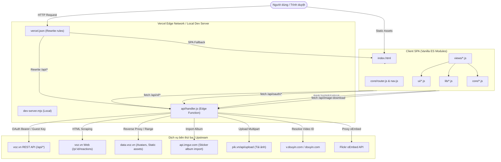

# TuiVoz — Tài liệu Kiến trúc, Cấu trúc Module & Hướng dẫn Triển khai (Deploy)

Tài liệu chi tiết toàn bộ kiến trúc mã nguồn, bản đồ tất cả tập tin JS/CSS/Assets, vai trò từng module và quy trình triển khai dự án **TuiVoz**.

---

## 1. Tổng quan Kiến trúc Hệ thống

**TuiVoz** là một ứng dụng web diễn đàn phong cách **voz.vn**, vận hành theo mô hình **Thin Client SPA (Single Page Application)** kết hợp **Edge Proxy / API Gateway**:



### Đặc điểm cốt lõi:
- **Không database riêng**: Dữ liệu người dùng, bài viết, thông báo, bình luận đọc/ghi trực tiếp qua REST API XenForo 2 của `voz.vn`.
- **Bảo mật token**: Client không bao giờ giữ `Guest Key` hay `OAuth Bearer Token` trực tiếp trong JavaScript. Phiên làm việc lưu trong cookie `voz_session` với các cờ `HttpOnly`, `Secure`, `SameSite=Lax`. Edge API proxy chịu trách nhiệm gắn header `Authorization` hoặc `XF-Api-Key`.
- **Zero build tool**: Không dùng bundler (Webpack, Vite, Rollup...), chạy chuẩn **native ES modules** trên trình duyệt hiện đại.
- **Tốc độ & Font tiếng Việt**: Preload font chữ tối ưu, chống FOUC/flash theme tối bằng inline script trước paint, cache thông minh.

---

## 2. Cấu trúc Thư mục Dự án

```
TuiVoz/
├── api/                                # Backend Edge Functions
│   ├── handler.js                      # Edge Function chính: API gateway, proxy, OAuth2, media handlers
│   └── index.js                        # Forwarder export config & handler cho /api
├── dev-server.mjs                      # HTTP dev server chạy local mô phỏng Vercel Edge & static files
├── package.json                        # Cấu hình dự án, lệnh dev & deploy
├── vercel.json                         # Cấu hình định tuyến, caching headers, edge regions
├── README.md                           # Giới thiệu tổng quan
├── LICENSE                             # Giấy phép GPL-3.0
└── public/                             # Root thư mục phục vụ tĩnh (Static Root)
    ├── index.html                      # HTML Shell chính của SPA
    ├── favicon.ico                     # Favicon trang web
    ├── robots.txt                      # Cấu hình crawler
    ├── site.webmanifest                # PWA manifest
    ├── userscript/
    │   └── voz-oauth-helper.user.js    # Userscript bắt mã uỷ quyền OAuth2 PKCE trên voz.vn
    └── assets/
        ├── api.js                      # Client SDK giao tiếp với Edge API (/api/xf/*, /api/oauth/*)
        ├── app.js                      # Entry point khởi tạo ứng dụng, listener toàn cục
        ├── core/                       # Nhân ứng dụng (Routing, DOM, Navigation, Paths, Icons, Utils)
        ├── lib/                        # Thư viện xử lý logic nghiệp vụ (BBCode, media, settings, stickers...)
        ├── ui/                         # Các thành phần giao diện (Editor, modal, post, theme, header menus...)
        ├── views/                      # Các view / màn hình tương ứng với các route
        ├── css/                        # Hệ thống stylesheet CSS
        ├── fonts/                      # Bộ webfonts WOFF2 subset latin + vietnamese
        └── img/                        # Icon và logo VOZ
```

---

## 3. Bản đồ & Chi tiết Chức năng Từng Module

### 3.1. Nhóm Backend & Edge Gateway (`api/` và Dev Server)

| Tập tin | Vai trò & Chi tiết xử lý |
|---|---|
| `api/handler.js` | **Cổng API trung tâm chạy trên Vercel Edge (region `sin1`)**: <br>• **OAuth2 + PKCE**: Trao đổi mã code lấy token (`/api/oauth/exchange`), tự động làm mới token hết hạn (`refreshTokens`), kiểm tra trạng thái đăng nhập (`/api/oauth/status`), đăng xuất thu hồi token (`/api/oauth/logout`). Token được mã hóa Base64URL lưu trong HttpOnly cookie `voz_session`.<br>• **XenForo Proxy (`/api/xf/*`)**: Nhận request từ client, tự động gắn header `Authorization: Bearer <token>` nếu đã đăng nhập, hoặc fallback sang `XF-Api-Key: <GUEST_KEY>`. Tự retry refresh token nếu nhận HTTP 401.<br>• **Proxy Tải ảnh pik.vn (`/api/pik/upload`)**: Chuyển tiếp multipart/form-data lên `pik.vn/api/upload` tránh CORS và giữ nguyên chữ ký số SHA-256.<br>• **Proxy Download ảnh / Avatar (`/api/image-download`)**: Bypass Cloudflare anti-bot khi đọc ảnh đại diện, hỗ trợ HTTP Range để đọc kích thước/frame đầu của GIF.<br>• **Proxy Imgur (`/api/xf/imgur/*`)**: Dùng Imgur Client-ID cố định từ server để tải album sticker, tránh lộ quota và vượt CORS.<br>• **Bypass Douyin (`/api/xf/douyin`)**: Phân giải URL rút gọn `v.douyin.com`, bắt redirect location để trích xuất `aweme_id` phục vụ player embed.<br>• **Proxy oEmbed (`/api/xf/oembed`)**: Phân giải Flickr oEmbed server-side để render BBCode `[MEDIA=flickr]`.<br>• **Scraping danh sách reaction (`/p/:id/reactions`)**: REST API XenForo không trả danh sách người thả cảm xúc, module này fetch trang HTML từ voz.vn, parse DOM và trả về JSON danh sách username, reaction id, ngày tạo kèm cache TTL 60s. |
| `api/index.js` | Re-export `handler.js` để Vercel route chuẩn xác cho endpoint `/api`. |
| `dev-server.mjs` | Web server Node.js chạy local (`node dev-server.mjs [port]`): tự động import `api/handler.js`, chuyển đổi `http.IncomingMessage` thành Web standard `Request`/`Response`, phục vụ static files từ thư mục `public/` với MIME type chuẩn, trả 404 cho asset thiếu và fallback về `index.html` cho các route SPA. |

---

### 3.2. Nhóm Lõi Ứng Dụng (`public/assets/core/`)

| Tập tin | Chức năng |
|---|---|
| `core/dom.js` | Quản lý các handle DOM gốc (`#app`, `#breadcrumbs`, `#header-account`, `#nav-list`, `#toast`, `#modal-root`) và `state` mutable toàn cục (`me`, `loggedIn`, `reactions`, `activeNav`, `breadcrumbs`). |
| `core/router.js` | History API Router chính: phân tích URL, tách phân trang `page-N`, điều phối routing đến các View tương ứng (`viewHome`, `viewForum`, `viewSearchForum`, `viewThread`, `viewSearch`, `viewDmList`, `viewDm`, `viewNewDm`, `viewAlerts`, `viewBookmarks`, `viewWatched`, `viewUser`, `viewCompose`, `viewSettings`, `viewLogin`). Hỗ trợ redirect bài viết `/p/:id` về đúng trang của thread, xử lý route nhảy tới bài chưa đọc `/t/:id/unread`. |
| `core/nav.js` | Điều hướng không reload trang (`navigate`), lưu vị trí cuộn trang (`saveScroll`, `restoreScroll`) theo từng entry history state tránh bị nhảy lên đầu trang khi back/forward, kiểm soát cờ `keepCurrentScroll` khi chuyển tới bookmark/post anchor. |
| `core/paths.js` | Định dạng đường dẫn URL chuẩn SEO phong cách voz.vn: slugify tiêu đề tiếng Việt loại bỏ dấu (`threadPath`, `forumPath`, `searchForumPath`, `userPath`, `dmPath`), trích xuất ID từ chuỗi `slug.id`, gắn hậu tố phân trang `withPage(path, page)`. |
| `core/icons.js` | Tập hợp icon vector SVG inline dạng hàm tối ưu (Bookmark, Search, Mail, Bell, Power, Comments, Eye On/Off, Quote, Reply, Report, Edit, Delete, User, Camera...) không phụ thuộc icon font. |
| `core/utils.js` | Tiện ích định dạng dữ liệu: escape HTML (`esc`), rút gọn số lượt xem/bình luận theo chuẩn K/M (`num`) hoặc hiển thị đầy đủ dựa theo cài đặt, định dạng thời gian tương đối (`timeAgo` - "vừa xong", "x phút trước") và ngày tháng tuyệt đối (`fullDate`, `postDate`, `joinDate`). |

---

### 3.3. Nhóm Xử Lý Nghiệp Vụ & Thư Viện (`public/assets/lib/`)

| Tập tin | Chức năng |
|---|---|
| `lib/attachments.js` | Registry ánh xạ attachment ID từ BBCode `[ATTACH]id[/ATTACH]` sang URL thực tế lấy từ mảng `post.Attachments[]`. |
| `lib/avatar.js` | Render avatar thành viên: tính toán URL avatar `https://data.voz.vn/avatars/...` theo quy tắc phân chia bucket `floor(user_id / 1000)`, tự động fallback về avatar ký tự viết tắt có màu nền ngẫu nhiên theo ID nếu ảnh lỗi. |
| `lib/avatarStatic.js` | Tính năng "Tắt ảnh động ảnh đại diện": fetch byte ảnh qua proxy, kiểm tra header/buffer GIF/APNG và đóng băng ảnh ở frame đầu tiên để giảm giật lag và chống phân tâm. |
| `lib/bbcode.js` | Xử lý BBCode & HTML: làm sạch mã HTML từ XenForo (`sanitizeHtml`), tái cấu trúc thẻ hình ảnh, nhúng smilies, giải mã media, phục hồi quote links và spoilers, chuyển BBCode sang văn bản thô (`bbcodeToPlain`). |
| `lib/editorCodec.js` | Bộ biên dịch BBCode 2 chiều độc lập cho Visual Editor: phân tích cú pháp chuỗi BBCode thành các node AST an toàn, chuyển đổi qua lại giữa BBCode và DOM Editor mà không làm hỏng cấu trúc chưa hỗ trợ. |
| `lib/imageDownload.js` | Tính năng nút "Tải ảnh": chèn nút tải bán trong suốt lên trên các ảnh lớn trong bài viết (diện tích > 20,000px²), xử lý fetch blob qua proxy nếu dính CORS để kích hoạt download. |
| `lib/imageFallback.js` | Xử lý thuộc tính `data-onerror="hide-parent"` từ HTML XenForo cho các favicon và ảnh unfurl bị lỗi để tránh hiển thị khung ảnh vỡ. |
| `lib/imgurImport.js` | Nhập album sticker từ link Imgur (`https://imgur.com/a/...`): gọi proxy `/api/xf/imgur/album/:id/images`, tải ảnh song song và lưu vào sticker storage. |
| `lib/jumpToAnchor.js` | Xử lý cuộn mượt và ghim đúng vị trí bài viết `#post-id` bên dưới sticky header; theo dõi hình ảnh tải muộn để bù trừ chiều cao mà không giật màn hình nếu người dùng đang chủ động cuộn. |
| `lib/media.js` | Bộ phân giải và hiển thị các loại Media nhúng: YouTube, TikTok, Facebook, Reddit iframe resizing, Twitter/X, SoundCloud, Douyin Aweme Player, Flickr... |
| `lib/pikUpload.js` | Client upload ảnh lên pik.vn: kiểm tra định dạng, resize ảnh lớn về kích thước tối đa 1920px (JPEG quality 0.85) bằng Canvas trước khi gửi, upload song song (3 luồng), sinh thẻ BBCode `[IMG]url[/IMG]`. |
| `lib/postLinks.js` | Viết lại các link nội bộ voz.vn trích dẫn trong bài viết (`/t/`, `/f/`, `/u/`, `/p/`) thành URL SPA của TuiVoz để không bị reload trang, giữ các link ngoài hoặc tác vụ web-only trên voz.vn. |
| `lib/postScreenshot.js` | Tính năng "Chụp bài viết": vẽ lại bài viết và tiêu đề thread lên canvas thông qua SVG `<foreignObject>`, proxy toàn bộ ảnh nhúng thành Data URI để không bị taint canvas, xuất ra file ảnh PNG chất lượng cao. |
| `lib/prefix.js` | Ánh xạ ID tiền tố thread (`prefix_id`) sang màu sắc chuẩn của voz.vn (Đỏ, Xanh lá, Xanh dương, Cam, Xám, Olive...) và render nhãn HTML. |
| `lib/quotes.js` | Quản lý trích dẫn: giới hạn độ cao tối đa 800px cho các quote dài, thêm hiệu ứng gradient mờ dần kèm nút "Click to expand...", mở rộng toàn bộ quote khi click. |
| `lib/settings.js` | Quản lý toàn bộ cấu hình người dùng lưu trong `localStorage['voz-settings:v1']`: theme (auto/light/dark), font chữ (7 bộ font), kích thước font chữ, chế độ hiển thị số liệu, auto-hide header, bookmark thanh menu, danh sách album sticker. Hỗ trợ import/export cấu hình dạng JSON. |
| `lib/signature.js` | Phân tích và render chữ ký của thành viên (`User.signature`) từ BBCode sang HTML an toàn, hỗ trợ màu sắc tên hoặc mã hex. |
| `lib/smilies.js` | Tải danh mục smilies từ `/voz/smilies`, biên dịch Regular Expression để thay thế text emoticon `:smile:`, `:brick:` thành thẻ `` mặt cười. |
| `lib/spoilers.js` | Xử lý thẻ `[SPOILER="Tiêu đề"]Nội dung[/SPOILER]`: render nút bấm toggle ẩn/hiện nội dung tương tác. |
| `lib/stickers.js` | Quản lý sticker tùy biến lưu trữ trên **IndexedDB (`TuiVozStickerStorage`)**: quản lý album, thêm sticker từ link/tải lên, lưu danh sách sticker dùng gần đây, cache ảnh offline. |
| `lib/unread.js` | Thuật toán dò bài chưa đọc đầu tiên: dựa vào `visitor_read_date` và tổng số trang, lùi dần qua các trang bài viết để định vị chính xác `post_id` chưa đọc. |
| `lib/userBadges.js` | Render các huy hiệu thành viên (Titles/Banners: Admin, Mod, Tày Tồ...) kèm màu sắc tương ứng. |

---

### 3.4. Nhóm Giao Diện & Component (`public/assets/ui/`)

| Tập tin | Chức năng |
|---|---|
| `ui/editor.js` | Trình soạn thảo trực quan Rich Text / BBCode: chuyển đổi qua lại giữa chế độ soạn thảo trực quan (contenteditable) và mã nguồn BBCode, lưu bản nháp (draft), hỗ trợ kéo thả & dán ảnh trực tiếp từ clipboard để tự upload lên pik.vn. |
| `ui/editorTools.js` | Thanh công cụ editor: các nút định dạng (Đậm, Nghiêng, Gạch chân, Căn lề, Link, Ảnh, Video, Trích dẫn, Code, Spoiler...), tích hợp bảng chọn Smilies và Sticker Picker. |
| `ui/stickerPicker.js` | Bảng chọn sticker popup: hiển thị danh sách sticker theo từng album tab, lịch sử sử dụng gần đây, nút thêm sticker nhanh và chèn mã `[IMG size="80x80"]url[/IMG]`. |
| `ui/post.js` | Template hiển thị bài viết chuẩn XenForo (`.message`): avatar tác giả, thông tin tham gia/số bài viết, huy hiệu, nội dung parsed, thanh công cụ tương tác (Trả lời, Trích dẫn, Sửa, Xóa, Báo cáo, Bookmark, Chụp ảnh, Thả cảm xúc). |
| `ui/inlineEdit.js` | Chỉnh sửa bài viết tại chỗ (Inline Edit): thay thế khối nội dung bài viết bằng trình soạn thảo trực tiếp không cần chuyển trang, lưu thay đổi qua API và khôi phục giao diện mượt mà. |
| `ui/reactions.js` | Thanh chọn cảm xúc tương tác: hover/click để chọn cảm xúc (Ưng, Tim, Gạch...), gọi API `/posts/:id/react`, render danh sách những người đã thả cảm xúc kèm avatar và tên. |
| `ui/postNumberPopup.js` | Popup liên kết bài viết khi click vào số thứ tự (`#13,661`): cung cấp link permalink gốc trên `voz.vn` và link nội bộ trên trang hiện tại để tiện sao chép. |
| `ui/threadRow.js` | Render một dòng chủ đề trong danh sách diễn đàn: icon trạng thái chưa đọc, prefix, tiêu đề, phân trang mini, tác giả, số trả lời/lượt xem, avatar và thông tin người bình luận cuối cùng. |
| `ui/forumNodes.js` | Render cây danh mục diễn đàn ở trang chủ hoặc danh mục con: tên diễn đàn, mô tả, số chủ đề/bài viết, bài viết mới nhất. |
| `ui/headerMenus.js` | Dropdown menu trên thanh header: thông báo (Alerts), hộp thư (Conversations/Direct Messages), menu người dùng và menu cài đặt nhanh. Tự động đóng khi click ra ngoài. |
| `ui/unreadCounts.js` | Polling và cập nhật số lượng thông báo / tin nhắn chưa đọc hiển thị dạng badge đỏ trên header. |
| `ui/chrome.js` | Render thông tin tài khoản trên header (`#header-account`), thanh điều hướng Breadcrumbs (`#breadcrumbs`), thanh menu chính và phím tắt điều hướng nhanh. |
| `ui/chromeAutoHide.js` | Hiệu ứng tự động ẩn thanh Header và Navigation khi cuộn xuống và hiện lại ngay khi cuộn lên một khoảng nhỏ (`REVEAL_THRESHOLD = 8px`), giúp tăng tối đa không gian đọc trên mobile. |
| `ui/infiniteScroll.js` | Cơ chế cuộn vô tận (Infinite Scroll) hỗ trợ 3 chế độ (Tự động tải thêm khi chạm đáy, Bấm nút tải thêm thủ công, hoặc Tắt để dùng phân trang truyền thống). Có nút nổi tạm dừng cuộn vô tận. |
| `ui/pagination.js` | Thanh phân trang: các nút trang trước/sau, danh sách số trang rút gọn, popup nhập số trang bất kỳ để nhảy nhanh (`wirePageJump`). |
| `ui/theme.js` | Bộ điều khiển giao diện: lắng nghe thay đổi Dark/Light mode (hỗ trợ theo dõi OS), nạp font chữ tương ứng và thiết lập biến CSS scale tỉ lệ giao diện (`--post-scale`, `--ui-scale`). |
| `ui/modal.js` | Hộp thoại Modal dùng chung: dialog xác nhận xóa, form gửi báo cáo bài viết vi phạm, popups cảnh báo. |
| `ui/feedback.js` | Thông báo Toast nhanh (`toast(msg, isError)`), trạng thái đang tải (`loading()`), khung hiển thị lỗi chi tiết từ API (`errorBox()`). |
| `ui/title.js` | Quản lý `document.title` tập trung: ghép nối tên chủ đề/diễn đàn, số trang và thương hiệu `VOZ`. |
| `ui/titleHold.js` | Xử lý sự kiện nhấn giữ vào tiêu đề bài viết để kích hoạt tính năng phụ (chỉnh sửa nhanh hoặc sao chép tiêu đề). |
| `ui/memberTooltip.js` | Card xem nhanh thông tin thành viên (Member Tooltip) khi hover vào tên hoặc avatar: hiển thị ngày tham gia, số bài viết, điểm phản ứng, danh hiệu. |
| `ui/session.js` | Khởi tạo phiên đăng nhập khi mở trang (`loadSession`), kiểm tra quyền truy cập yêu cầu đăng nhập (`requireLogin`). |
| `ui/alertMarkup.js` | Định dạng nội dung thông báo: phân tích loại tương tác (được quote, được nhắc đến, có người phản hồi, thả reaction) và chèn icon cảm xúc tương ứng. |

---

### 3.5. Nhóm Màn Hình / Views (`public/assets/views/`)

| Tập tin | Chức năng & Giao diện tương ứng |
|---|---|
| `views/forum.js` | • `viewHome()`: Trang chủ danh sách toàn bộ các chuyên mục/diễn đàn (Node Tree).<br>• `viewForum(id, page)`: Danh sách chủ đề của một diễn đàn, hỗ trợ lọc, sticky threads, phân trang, cuộn vô tận.<br>• `viewSearchForum(id, page)`: Danh mục dạng Search Forum tổng hợp.<br>• `viewNewThreads(page)`: Danh sách các bài viết mới nhất trên toàn diễn đàn (`/new`). |
| `views/thread.js` | **Màn hình chi tiết chủ đề (`/t/:slug.:id/`)**: Hiển thị danh sách bài viết theo trang, xử lý scroll anchor tới bài viết cụ thể, theo dõi chủ đề (Watch/Unwatch), form trả lời nhanh ở cuối trang tích hợp visual editor, tương tác bài viết (Sửa, Xóa, Quote, Báo cáo, Bookmark, Thả cảm xúc). |
| `views/compose.js` | **Màn hình đăng chủ đề mới (`/f/:id/post-thread`)**: Form nhập tiêu đề, chọn prefix, soạn nội dung với rich editor, xử lý submit qua API tạo bài mới. |
| `views/dm.js` | **Hệ thống Hộp thư / Tin nhắn riêng (`/direct-messages/`)**:<br>• `viewDmList(page)`: Danh sách cuộc trò chuyện.<br>• `viewDm(id, page)`: Chi tiết cuộc trò chuyện và form trả lời tin nhắn.<br>• `viewNewDm(to)`: Soạn tin nhắn mới gửi đến thành viên cụ thể. |
| `views/lists.js` | **Các danh sách cá nhân**:<br>• `viewAlerts(page)`: Danh sách thông báo, tự động đánh dấu đã đọc.<br>• `viewBookmarks(page)`: Danh sách các bài viết đã đánh dấu lưu lại.<br>• `viewWatched(page)`: Danh sách các chủ đề đang theo dõi có bài viết mới. |
| `views/search.js` | **Tìm kiếm (`/search`)**: Giao diện form tìm kiếm bài viết theo từ khóa và hiển thị kết quả phân trang lấy từ Search API của XenForo. |
| `views/user.js` | **Hồ sơ thành viên (`/u/:slug.:id/`)**: Xem trang cá nhân, avatar lớn, ngày đăng ký, thống kê hoạt động, chữ ký, nút tìm kiếm toàn bộ bài viết của người đó. |
| `views/login.js` | **Đăng nhập (`/login`)**: Hướng dẫn đăng nhập OAuth2 + PKCE bằng Userscript hoặc mã thủ công, gửi mã `code` và `verifier` về backend để thiết lập cookie phiên. |
| `views/settings.js` | **Cài đặt TuiVoz (`/cai-dat-tuivoz`)**: Giao diện quản lý cấu hình sâu rộng chia làm các tab:<br>• *Giao diện*: Chọn 7 loại phông chữ, cỡ chữ bài viết, cỡ chữ UI, theme Sáng/Tối/Tự động.<br>• *Hệ thống*: Chế độ cuộn vô tận, tự ẩn header, tắt avatar động, bật nút tải ảnh, chụp bài viết, hiện số đầy đủ.<br>• *Phím tắt*: Tùy biến các đường dẫn shortcut ghim lên thanh menu chính.<br>• *Stickers*: Quản lý các bộ sưu tập sticker cá nhân, nhập từ Imgur, thêm/sửa/xóa sticker.<br>• *Sao lưu*: Xuất file JSON cấu hình và khôi phục dữ liệu. |

---

### 3.6. Nhóm Stylesheets (`public/assets/css/`)

| Tập tin CSS | Nhiệm vụ |
|---|---|
| `base.css` | Thiết lập các CSS Custom Properties (biến CSS màu sắc theme Sáng/Tối, palette màu lấy chuẩn từ voz.vn, bán kính bo góc, font hệ thống cơ bản). |
| `font-default.css` | Khai báo font mặc định `Be Vietnam` (weight 400) tải tức thì cùng HTML shell. |
| `fonts.css` | Khai báo các font nhúng tùy chọn (Be Vietnam Pro, Roboto, Cantarell, Segoe UI, SF Pro Display) tải theo nhu cầu khi người dùng cấu hình. |
| `layout.css` | Layout khung trang web: Header cố định, Navigation menu, Breadcrumbs, Body wrapper, Footer. |
| `theme.css` | Quy tắc hiển thị nâng cao phản ứng theo theme dark/light và chế độ màu sắc hệ thống. |
| `forum.css` | Cấu trúc bảng danh mục diễn đàn, danh sách chủ đề (`.structItem`), cột tác giả, cột thống kê và bài mới nhất. |
| `post.css` | Giao diện bài viết (`.message`): cột user info bên trái, nội dung bài viết, khung quote, block code, chữ ký thành viên. |
| `editor.css` | Giao diện trình soạn thảo trực quan: Toolbar các nút bấm, vùng gõ contenteditable, panel popup chọn sticker/smilies. |
| `forms.css` | Style chuẩn cho các nút bấm (`.button`), ô input, textarea, select dropdown, checkbox, radio. |
| `media.css` | Style cho các thẻ nhúng media (YouTube, TikTok, Facebook video...) và thẻ xem trước liên kết (Unfurl link preview card). |
| `reaction.css` | Nút bấm và popup thả cảm xúc (Ưng, Gạch, HaHa, Tim...). |
| `headerMenus.css` | Dropdown panel cho thông báo, tin nhắn riêng và menu cá nhân trên thanh header. |
| `home.css` | Tinh chỉnh giao diện riêng cho trang chủ Node Index. |
| `account.css` | Style cho giao diện tin nhắn riêng, danh sách thông báo, hồ sơ cá nhân và trang đăng nhập. |
| `settings.css` | Giao diện trang cài đặt TuiVoz: danh sách tab, bảng quản lý phím tắt, giao diện backup JSON. |
| `stickers.css` | Lưới hiển thị sticker picker, khung quản lý album và preview sticker. |
| `avatar.css` | Style cho avatar thành viên tròn/vuông, avatar ký tự chữ cái và nhãn huy hiệu prefix. |
| `misc.css` | Các trạng thái phụ: màn hình chờ tải (loading spinner), thông báo trống rỗng (empty state), popup modal, thông báo toast. |
| `responsive.css` | Responsive Breakpoints tối ưu cho tablet và điện thoại màn hình nhỏ. |
| `app.css` | File CSS tổng hợp gộp các file nguồn (sử dụng khi cần build bundle). |

---

### 3.7. Nhóm Tiện Ích Trợ Giúp (`public/userscript/`)

- `voz-oauth-helper.user.js`: Kịch bản Tampermonkey / Violentmonkey tự động chạy trên `https://voz.vn/oauth2/*`. Kịch bản này tự động tạo cặp khóa PKCE (`code_challenge` / `code_verifier`), bắt lấy `authorization_code` sau khi đăng nhập thành công trên diễn đàn và chuyển tiếp mã code về cho ứng dụng TuiVoz để hoàn tất đăng nhập một cách tự động và tiện lợi.

---

## 4. Cấu hình Định tuyến & Proxy (Vercel & Dev Server)

Cấu hình trong `vercel.json`:
- **Region**: Chỉ định chạy tại datacenter `sin1` (Singapore) gần với máy chủ `voz.vn` nhất, giúp giảm độ trễ API xuống mức thấp nhất.
- **Rewrites**:
  - `/api` ➔ `/api/handler?__path=`
  - `/api/(.*)` ➔ `/api/handler?__path=$1`
  - Các đường dẫn SPA khác (ngoại trừ `/api/`, `/assets/`, `/userscript/`, `robots.txt`) đều fallback về `/index.html`.
- **Headers & Caching**:
  - `/api/(.*)`: `private, no-store, max-age=0` (Không cache API động).
  - `/assets/(.*)`: `public, max-age=3600, stale-while-revalidate=86400` (Cache tài nguyên tĩnh 1 giờ, cho phép dùng cache cũ trong khi fetch mới tối đa 1 ngày).

---

## 5. Quy Trình Triển Khai (Deployment Guide)

### 5.1. Yêu cầu môi trường
- **Node.js**: Phiên bản 18.x trở lên (khuyên dùng Node.js 20+ để tương thích chuẩn Web API Fetch/Request/Response).
- **Vercel CLI**: Cài đặt thông qua npm nếu triển khai bằng command line:
  ```powershell
  npm install -g vercel
  ```

---

### 5.2. Chạy thử nghiệm tại Local (Development)

1. Mở PowerShell hoặc Terminal tại thư mục `TuiVoz`:
   ```powershell
   cd "D:\Data 2\Github-Clone\siritami\TuiVoz"
   ```
2. Khởi chạy máy chủ phát triển nội bộ:
   ```powershell
   node dev-server.mjs 3000
   ```
3. Truy cập vào trình duyệt:
   ```
   http://localhost:3000
   ```
   *Lưu ý: Dev server đã tích hợp sẵn proxy `/api/*` và phục vụ toàn bộ file tĩnh từ thư mục `public/` giống hệt môi trường Edge trên Vercel.*

---

### 5.3. Triển khai lên Vercel (Production)

#### Cách 1: Triển khai trực tiếp qua Vercel CLI (Khuyên dùng)
1. Đăng nhập Vercel (nếu chưa đăng nhập):
   ```powershell
   vercel login
   ```
2. Kiểm tra trước ở môi trường Preview:
   ```powershell
   vercel
   ```
3. Triển khai chính thức lên Production:
   ```powershell
   vercel --prod
   ```

#### Cách 2: Triển khai qua GitHub / GitLab / Bitbucket
1. Đẩy mã nguồn lên repository Git của bạn.
2. Truy cập [Vercel Dashboard](https://vercel.com/new).
3. Chọn Import Git Repository.
4. Tại phần **Root Directory**, nếu repo chứa cả dự án cha thì chọn đường dẫn là `TuiVoz`, hoặc để trống nếu `TuiVoz` là thư mục gốc của repository.
5. **Framework Preset**: Chọn **Other**.
6. **Output Directory**: Nhập `public` (hoặc để Vercel tự đọc từ file `vercel.json`).
7. Nhấn **Deploy**.

---

## 6. Tổng Kết

Toàn bộ 65 tập tin JS, 20 tập tin CSS cùng các tài nguyên font chữ và hình ảnh trong dự án `TuiVoz` tạo nên một cấu trúc chặt chẽ, hoạt động không cần cơ sở dữ liệu nội bộ và bảo mật tuyệt đối thông qua tầng Edge Proxy. Tài liệu này cung cấp đầy đủ bản đồ kỹ thuật phục vụ việc bảo trì, phát triển tính năng mới và triển khai dự án lên môi trường production.
